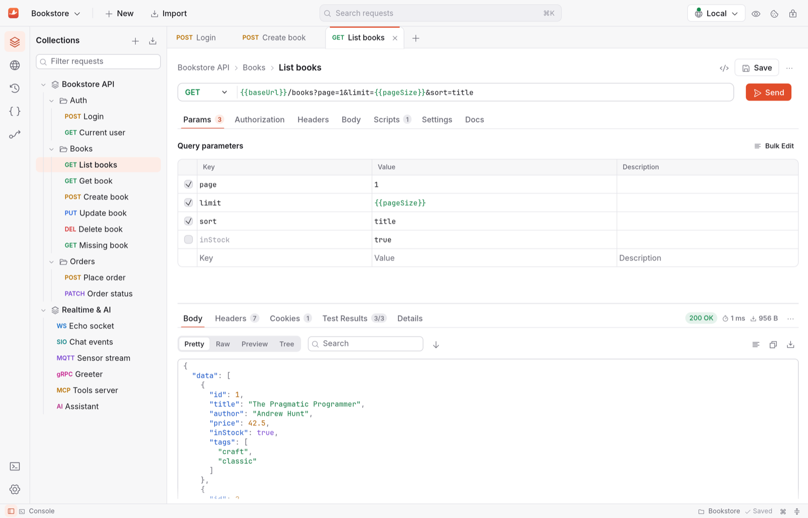
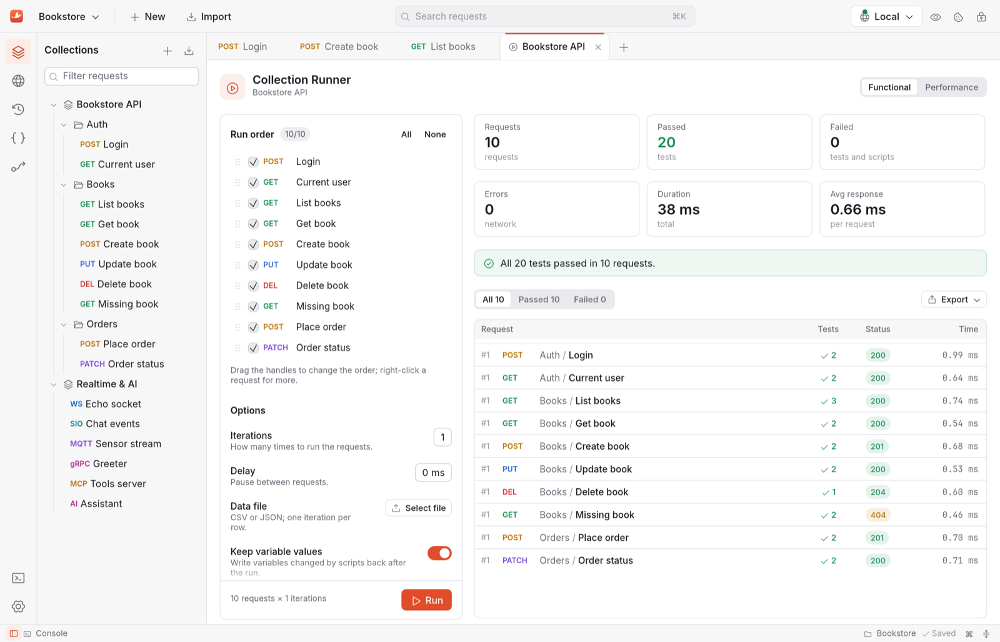
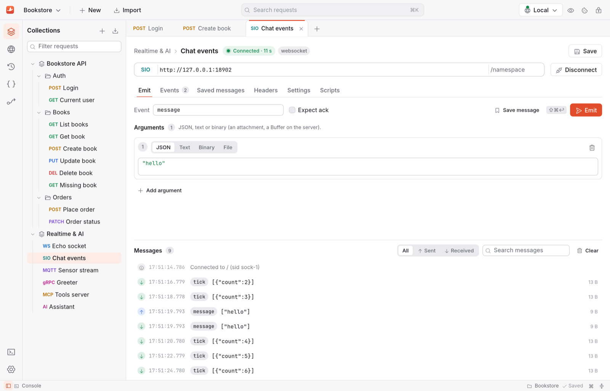
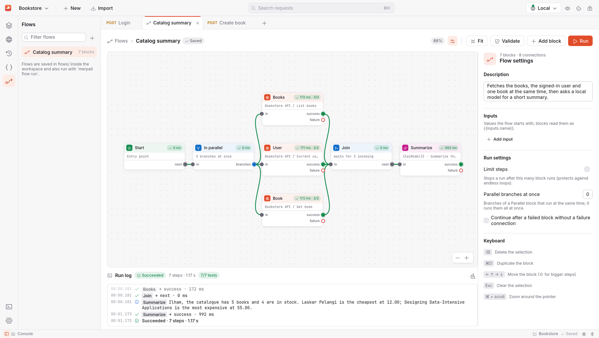
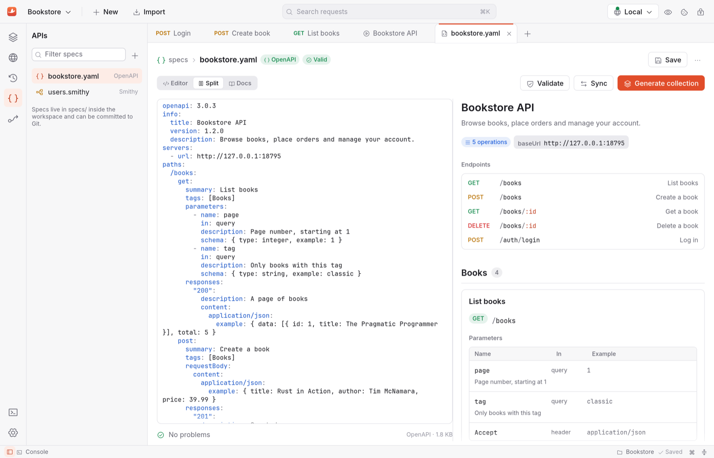
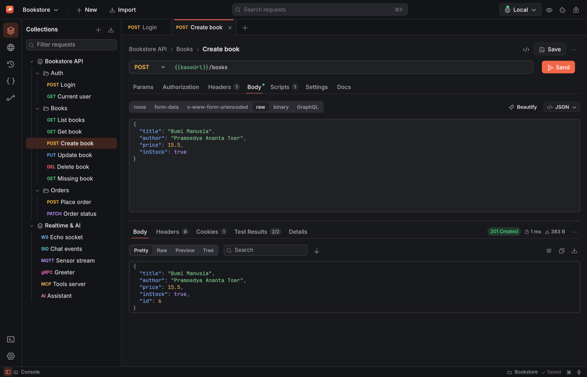
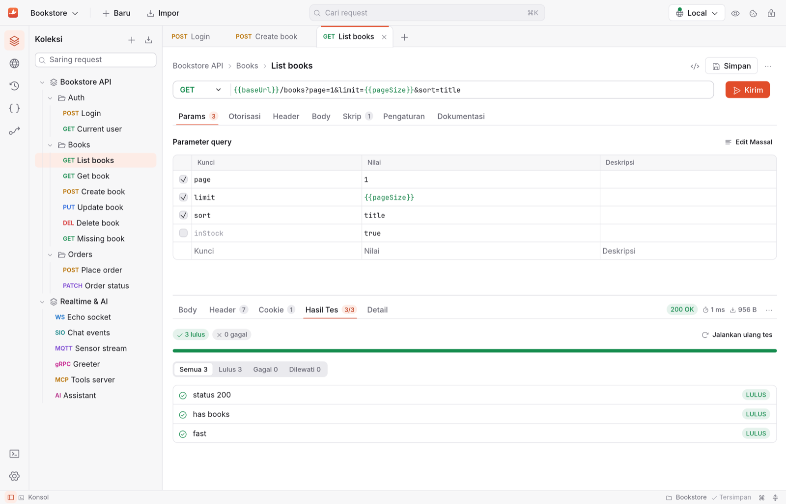

# Merpati

**A lightweight API client, written entirely in Rust.**

Merpati is a native alternative to Postman: one small binary, no Electron, no Node.js, no account.
It draws its first frame in about 40 ms, idles at 0 % CPU and uses under 90 MB of memory, and a
100 MB response streams to disk instead of into memory. Collections are plain JSON files in a
folder you can commit to Git, and Postman collections, environments and `pm.*` scripts import and
run unchanged for common use.

[Bahasa Indonesia](README.id.md)



## Highlights

- **HTTP, GraphQL, gRPC, WebSocket, Socket.IO, MQTT, SOAP, MCP and AI model requests** in one app,
  each with its own tab, message log and scripts.
- **Postman compatible**: collections v2.0/v2.1, environments and globals import and export; `pm.*`
  scripts run on an embedded JavaScript engine with the real Chai, lodash, moment, crypto-js and
  tv4 (a corpus of 50 realistic Postman scripts passes 50/50).
- **Git-friendly workspaces**: one pretty-printed file per request, stable ordering, and secrets
  never written to the workspace; they live in the Keychain.
- **Collection Runner and CLI** with data files, JUnit/HTML/JSON reports and **newman-compatible
  options**, so `merpati run` can replace `newman run` in CI. Performance tests with virtual users.
- **Flows**: a visual canvas that chains requests, conditions, loops, parallel branches, scripts and
  AI calls, and runs from the app or the CLI.
- **Spec Hub** for OpenAPI, AsyncAPI, Protobuf, GraphQL and Smithy files with live validation, a
  live docs preview and spec ⇄ collection sync.
- **Mock server, webhook listener and capture proxy**, all local.
- Twelve auth types, from Basic and OAuth 2.0 to AWS SigV4, NTLM and Akamai EdgeGrid.
- English and Indonesian UI, light and dark themes, keyboard and screen-reader friendly, no
  telemetry.
- **Updates** from GitHub releases; on macOS one click installs the new version and restarts.

## Install

The app runs on macOS 12 Monterey or later (Apple Silicon and Intel, one universal build), Linux
x86_64 and Windows x86_64. macOS is the main platform; see [Known limitations](#known-limitations).

### One-line installer (macOS, recommended)

```sh
curl -fsSL https://raw.githubusercontent.com/ilhamnadhif/merpati/master/scripts/install.sh | bash
```

The script downloads the latest release, checks it (the SHA-256 GitHub publishes, the bundle id,
the version and the code signature), quits a running Merpati, installs `Merpati.app` into
`/Applications` and opens it. If anything fails, the copy you had stays in place. Run it again to
update. To install a specific version, pass it as an argument: `… | bash -s -- v0.1.0`. To install
somewhere else, set `MERPATI_APP_DIR` for bash: `… | MERPATI_APP_DIR=~/Applications bash`.

### Disk image

Download **`Merpati-<version>-universal.dmg`** from the
[latest release](https://github.com/ilhamnadhif/merpati/releases/latest), open it and drag
**Merpati** onto **Applications**.

> **“Merpati” Not Opened / “Apple could not verify…”?** Release builds are not notarized by Apple
> yet (they are signed ad hoc), so macOS blocks apps downloaded with a browser. Since macOS 15, the
> old right-click → Open trick no longer works. Do one of these:
>
> - **Use the one-line installer** above. Nothing downloaded with `curl` is blocked.
> - **Allow it once in Settings**: click **Done** in the warning, open **System Settings → Privacy &
>   Security**, scroll down to **Security**, and click **Open Anyway** next to “Merpati was
>   blocked…”. Confirm with your password, then open Merpati again.
> - **Or in Terminal**, after dragging the app to Applications:
>   `xattr -dr com.apple.quarantine /Applications/Merpati.app`

### Homebrew

Each release includes a cask file, `merpati.rb`:

```sh
curl -fsSLO https://github.com/ilhamnadhif/merpati/releases/latest/download/merpati.rb
brew install --cask ./merpati.rb
xattr -dr com.apple.quarantine /Applications/Merpati.app   # until releases are notarized
```

The cask also links `merpati-app` into Homebrew's `bin`.

### Linux and Windows

Download from the [latest release](https://github.com/ilhamnadhif/merpati/releases/latest):

- **`merpati-<version>-linux-x86_64.tar.gz`**: the app (`merpati-app`), the CLI (`merpati`), a
  `.desktop` file and an icon. Unpack it and run `./merpati-app`, or copy the binaries into a folder
  on your `PATH` (such as `~/.local/bin`) and the `.desktop` file into
  `~/.local/share/applications`.
- **`merpati-<version>-windows-x86_64.zip`**: `merpati-app.exe` and `merpati.exe`. Unpack and run
  `merpati-app.exe`.

Both are built by the release workflow on GitHub Actions; each release also has
`SHA256SUMS-linux.txt` and `SHA256SUMS-windows.txt` to check them with.

### Command line only

The CLI is a single binary as well. For macOS, take `merpati-cli-<version>-macos-universal.tar.gz`
from the release (the Linux and Windows archives above contain it too):

```sh
curl -fsSL https://github.com/ilhamnadhif/merpati/releases/download/v0.1.0/merpati-cli-0.1.0-macos-universal.tar.gz | tar -xz
sudo mv merpati /usr/local/bin/
merpati --version
```

Or build it with Cargo (Rust 1.88 or later), or use the Docker image:

```sh
cargo install --locked --git https://github.com/ilhamnadhif/merpati merpati-cli

docker build -f docker/Dockerfile -t merpati .
docker run --rm -v "$PWD:/work" merpati run collection.json -e env.json -r cli,junit
```

### Updates

When it starts, Merpati asks GitHub for the latest release. That request sends only the app's
version as its User-Agent; turn it off in **Settings › General › Updates** (where **Check now**
checks right away). When a newer version is out, a window shows its release notes with the choice
to install it, be reminded later, or skip that version.

- **On macOS**, **Install and restart** downloads the app archive
  (`Merpati-<version>-macos-universal.zip`), verifies it (the SHA-256 GitHub publishes, the bundle
  id, the version and the code signature), replaces `Merpati.app` and opens the new version.
- **On Linux and Windows**, Merpati downloads the archive for your system to the Downloads folder,
  checks it against the release's `SHA256SUMS-*.txt` (a download without a checksum is refused) and
  opens it; you replace the files yourself.

The one-line installer above also updates.

### Uninstall

```sh
rm -rf /Applications/Merpati.app
rm -rf ~/Library/Application\ Support/Merpati   # settings, the default workspace, package cache
```

Workspaces you created elsewhere stay where you put them. Saved secrets are Keychain items with the
service name `dev.merpati.workspace`; remove them in Keychain Access.

## Getting started

1. Open Merpati. It opens your last workspace, or creates **My Workspace** in its settings folder.
   Use the workspace menu (top left) to create or open a workspace anywhere, for example inside a
   Git repository.
2. Click **Import** to bring in a Postman collection, an OpenAPI file, a cURL command, a HAR file
   and more, or **New** for a request of any protocol.
3. Pick an environment (`⌘E`), type a URL and press `⌘↩`. `{{variables}}` are highlighted, and
   hovering one shows its value.
4. Right-click a collection or folder and choose **Run collection** (or **Run folder**) to run its
   requests and tests, or run the same collection in a terminal with `merpati run`.

## Features

### Requests and responses

- Every HTTP method, plus custom ones. Query parameters and `:path` variables stay in sync with the
  URL; headers have autocomplete, and the automatic headers can be seen and turned off.
- Bodies: none, form-data (text and files), x-www-form-urlencoded, raw (JSON, XML, text,
  JavaScript, HTML), binary and GraphQL. **Beautify** keeps `{{variables}}` intact.
- Per request: redirects, TLS verification, URL encoding, timeouts, HTTP/1.1 or HTTP/2.
- Responses as Pretty, Raw, Preview or Tree, with headers, cookies, test results and timings
  (TTFB and total), search, save to a file or as an example. Large responses are streamed to a
  temporary file and shown virtually, so a 100 MB response of half a million lines keeps the UI
  responsive.
- `pm.visualizer` templates render inside the app (Handlebars, HTML and a CSS subset with grid,
  flexbox, floats and positioning).
- A cookie jar per domain (RFC 6265) you can view and edit, extra CA certificates, client
  certificates per host (PEM or PKCS#12), proxies (HTTP, HTTPS, SOCKS4/5, the system settings, PAC
  scripts and WPAD), Unix sockets (`http://unix:/var/run/docker.sock:/info`) and Windows named
  pipes.
- A searchable history with secret values masked.
- Code snippets in 18 flavours: cURL, raw HTTP, HTTPie, wget, fetch, axios, Python, Go, Rust, Java
  (two), Kotlin, C#, PHP, Swift, Ruby, Dart and PowerShell.

### Authentication

API key, Basic, Bearer, Digest, JWT, OAuth 1.0, OAuth 2.0 (authorization code with PKCE, implicit,
password, client credentials, automatic refresh), Hawk, AWS Signature v4, NTLM (with channel
binding), Akamai EdgeGrid and Atlassian ASAP, checked against the official test vectors where they
exist. Auth is inherited from the collection and folder; OAuth tokens are kept in the Keychain.

### Collections, environments and variables

- Nested folders, drag and drop (also between collections), duplicate, rename; auth, scripts,
  variables and a description on every collection and folder; search by name, URL or content.
- **Import**: Postman collections (v2.0, v2.1), environments and globals, cURL, OpenAPI 3 and
  Swagger 2, Insomnia, HAR, Hoppscotch, Thunder Client, WSDL (SOAP) and Smithy. **Export**: Postman
  v2.1 (a round trip gives the same file) and OpenAPI.
- Five variable scopes with Postman's precedence, initial values (in the workspace) and current
  values (local only), a secret type that is masked and never written to a file, 118 dynamic
  variables such as `{{$guid}}` and `{{$randomEmail}}`, and a vault: `{{vault:name}}` reads a value
  from the Keychain or from HashiCorp Vault, AWS Secrets Manager, Azure Key Vault or 1Password.
- **Local forks**: fork a collection, pull changes from its parent or merge back, with a three-way
  diff and a choice for every conflict.

### Scripts and tests

- Pre-request and post-response scripts on collections, folders and requests, in Postman's order,
  with `pm.test`/`pm.expect`, `pm.sendRequest` (callbacks or `await`), `pm.environment`,
  `pm.collectionVariables` and the rest of `pm`, plus the legacy `tests[]` and `postman.*`.
- Scripts for the other protocols too: before a gRPC call and on each message, on every
  WebSocket, Socket.IO and MQTT message, around MCP calls and AI requests.
- npm and JSR packages through `pm.require('npm:zod@3')`, cached for offline use and pinned by
  SHA-256 in a lockfile; a Package Library in the workspace for your own modules; `Intl` and Web
  Streams.
- Scripts run in a separate worker process with a time limit and a memory limit, so a runaway
  script cannot freeze or crash the app.
- A console with script logs, network lines and errors; snippets and `pm.` autocomplete; re-run
  the tests without sending the request again.

Details: [docs/scripting.md](docs/scripting.md).

### Collection Runner and performance tests



- Run a collection or folder with an environment, iterations, a delay, a CSV or JSON data file,
  `pm.execution.setNextRequest`/`skipRequest`, a custom order and simulated network failures.
- Results per request and iteration; export as JSON, JUnit or HTML. Runs continue in the
  background, can be cancelled and keep memory flat over thousands of iterations.
- Every protocol runs in the Runner: gRPC, AI and MCP calls, and WebSocket, Socket.IO and MQTT as
  scripted sessions (connect, send the saved messages, stop after N messages, an event or a quiet
  period).
- Performance tests with virtual users and ramp-up: latency percentiles (p50 to p99), throughput
  and errors, in the app or with `merpati perf`.

### Protocols



- **GraphQL**: queries, mutations and subscriptions (graphql-transport-ws), variables,
  introspection, a schema explorer and autocomplete in the editor.
- **gRPC**: schemas from `.proto` files (compiled in-process, with import paths) or server
  reflection; unary, client streaming, server streaming and bidirectional calls; metadata,
  deadlines, TLS and mTLS.
- **WebSocket**: headers, subprotocols, text and binary messages, saved messages, a timestamped
  log.
- **Socket.IO** v2 to v4: long-polling with upgrade or WebSocket only, namespaces, the `auth`
  payload, events, acknowledgements and binary attachments.
- **MQTT** 3.1.1 and 5 over TCP, TLS, WebSocket and secure WebSocket: subscriptions per QoS,
  publish with QoS and retain, last will, MQTT 5 user properties.
- **SOAP**: requests with envelope and SOAPAction from a WSDL.
- **MCP** (Model Context Protocol) servers over stdio, Streamable HTTP or the older SSE transport:
  tools, resources and prompts, OAuth, sampling, elicitation, roots, and a config export.
- **AI requests** to OpenAI, Anthropic, Google Gemini and OpenAI-compatible servers (Ollama, LM
  Studio, vLLM): streaming with time to first token and token counts, multi-turn conversations, and
  tools from your MCP requests.

Message logs are virtualized, so tens of thousands of messages stay smooth.

### Flows



Flows chain blocks on a canvas: Start, Request (saved or inline), Condition, Loop, Parallel, Join,
Script, AI, Delay, Set Variable, Template, Output and Log. Parallel branches really run at the same
time and a Join waits for the branches that can reach it. Each block shows its status and timing
while the flow runs, AI answers stream onto the canvas, and problems are flagged before you run.
Flows are saved as `flows/*.flow.json` in the workspace and run from the CLI with
`merpati flow run`.

### API design: Spec Hub



- Specs live in the workspace's `specs/` folder: OpenAPI 3 and Swagger 2, AsyncAPI, Protobuf,
  GraphQL SDL and Smithy (IDL 2.0 and JSON AST, models over many files, `smithy-build.json`).
- An editor with live validation and a list of problems, templates, and a documentation preview
  next to the editor.
- **Generate collection** from an OpenAPI or Smithy spec, or update an existing one (requests are
  added and changed, your scripts and tests stay); export a collection as OpenAPI.
- Documentation for a collection as Markdown or a static HTML site with code samples, from the
  app or `merpati docs`.

### Mock server, webhooks and capture

- **Mock server** from a collection's examples, with Postman-style matching, dynamic templates,
  network simulation (latency, jitter, bandwidth, 4G/3G/satellite presets) and failure simulation
  (error statuses, dropped connections, timeouts). One click points `{{baseUrl}}` at it.
- **Webhook listener**: a local HTTP endpoint that records every request (method, path, headers,
  body), answers with the response you set, and replays events to another URL.
- **Capture proxy**: an HTTP/HTTPS proxy with its own local CA (its key stays in the Keychain) to
  record the traffic of other apps, decrypt HTTPS per host, filter, save requests to a collection
  and export HAR (WebSocket messages included).

### The app



- Its own design system: Inter and JetBrains Mono, Phosphor icons, light and dark themes with a
  coral accent, browser-like tabs, a command palette (`⇧⌘P`) and quick search (`⌘K`).
- Open tabs, including unsaved ones, are restored after a restart or a crash. Closing an edited new
  request or spec asks first.
- English and Indonesian (Settings › General › Language).
- Accessible: keyboard navigation, and every button, tab, sidebar row and field has a name for
  screen readers (via AccessKit).



## Keyboard shortcuts

| Action | Shortcut |
| --- | --- |
| Send request | `⌘↩` |
| New request / new tab / close tab | `⌘N` / `⌘T` / `⌘W` |
| Next / previous tab | `⇧⌘]` / `⇧⌘[` |
| Save | `⌘S` |
| Search requests | `⌘K` |
| Command palette | `⇧⌘P` |
| Switch environment | `⌘E` |
| Toggle sidebar | `⌘B` |
| Console | `⌥⌘C` |
| Settings | `⌘,` |
| Accept a variable suggestion | `Tab` |

`⌘` is Ctrl on Windows and Linux.

## Command line

```text
merpati run       Run a collection (newman-compatible options)
merpati schedule  Run a collection repeatedly (--every 5m), keeping each run's results
merpati mock      Start a mock server from a collection's examples
merpati import    Import Postman, OpenAPI, Insomnia, HAR, cURL, … into a workspace
merpati export    Export a collection, environment or globals
merpati convert   Convert any importable file to Postman or OpenAPI
merpati validate  Check a file or workspace for errors and undefined variables
merpati codegen   Generate a code snippet for a request
merpati perf      Load test requests with virtual users
merpati docs      Generate documentation (static HTML site or Markdown)
merpati flow      Run, list and validate Flows
merpati init      Create an empty workspace
```

`merpati run` takes a Postman collection file, a Merpati workspace or a collection folder, and the
options you know from newman: `-e`, `-g`, `-d`, `-n`, `--folder`, `--env-var`, `--global-var`,
`--delay-request`, `--timeout`, `--timeout-request`, `--timeout-script`, `-k`, `--bail`, `-x`,
`-r cli,json,junit,html` with `--reporter-*-export`, `--export-environment`, `--export-globals`,
`--export-collection`, `--cookie-jar`, `--export-cookie-jar`, `--ssl-client-cert`/`-key`/`-passphrase`,
`--ssl-client-cert-list`, `--ssl-extra-ca-certs`, `--color`, `--disable-unicode`, `--silent` and
`--verbose`. It exits with 0 when everything passed, 1 when a request, test or script failed, and 2
on usage or load errors, so it can gate CI. Credentials (Authorization and Cookie headers, API keys,
passwords in URLs, tokens in query strings) are masked in reports and terminal output unless you
pass `--show-secrets`.

```sh
merpati run postman_collection.json -e staging.postman_environment.json -d users.csv \
  -r cli,junit --reporter-junit-export report.xml
merpati init my-api && merpati import postman_collection.json -w my-api
merpati run my-api -e Staging --folder "Smoke tests" --bail
merpati mock my-api --port 3000 --network slow-3g --fail-rate 0.1 --fail-with timeout
merpati perf my-api --vus 20 --duration 30s
merpati flow run my-api "Catalog summary" -e Staging
merpati docs my-api -o site/ --languages curl,python    # or --markdown -o API.md
```

`merpati <command> --help` lists every option.

## GitHub Action

The repository is also a GitHub Action ([`action.yml`](action.yml)) that builds the CLI and runs a
collection, writing a JUnit report:

```yaml
- uses: actions/checkout@v4
- uses: ilhamnadhif/merpati@v0.1.0
  with:
    collection: api/                 # Postman collection file, workspace or collection folder
    environment: Staging             # Postman environment file or workspace environment name
    reporters: cli,junit
    args: --bail --env-var baseUrl=https://staging.example.com
- uses: actions/upload-artifact@v4
  if: always()
  with:
    name: api-tests
    path: merpati-reports/junit.xml
```

Other inputs: `collection-name`, `iteration-data`, `junit-export` and `version` (the Git ref of
Merpati to build). The action compiles the CLI with Cargo and caches the build between runs. It
has not been tried on GitHub's own runners yet, so please report any problem.

## Workspace format

```text
my-api/
  merpati.json                      manifest
  .gitignore                        ignores .merpati/
  globals.json
  environments/staging.json         initial values only; secrets left blank
  collections/bookstore-api/
    collection.json                 auth, scripts, variables, child order
    books/folder.json
    books/list-books.request.json   one pretty-printed file per request
  flows/catalog-summary.flow.json
  specs/bookstore.yaml
  packages/                         your own script modules
  .merpati/                         local only: current values, cookies, history, open tabs
```

## Privacy and security

- No account and no telemetry. Merpati connects only to the servers you send requests to and, if
  you leave the update check on, to GitHub once at start (with only the app version as
  User-Agent).
- Secret-type variables, sensitive auth fields (passwords, tokens, client secrets, private keys),
  OAuth tokens, proxy passwords and certificate passphrases go to the macOS Keychain (one item per
  workspace), never to workspace files, exports, history or run reports. On systems without a
  keychain (CI, containers) they go to `.merpati/secrets.json`, which the workspace's `.gitignore`
  keeps out of Git.
- TLS certificates are verified by default. Scripts run in a sandbox without file or network
  access except through `pm`, in a separate process with time and memory limits.
- Links in visualizer output, spec documentation and OAuth/MCP flows only open `http(s):` and
  `mailto:`, never local files or apps.

| What | Where (macOS) |
| --- | --- |
| Settings | `~/Library/Application Support/Merpati/settings.json` |
| Default workspace | `~/Library/Application Support/Merpati/workspaces/My Workspace` |
| npm/JSR package cache | `~/Library/Application Support/Merpati/package-cache` |
| Current values, cookies, history, open tabs | `.merpati/` inside each workspace |
| Secrets | macOS Keychain, service `dev.merpati.workspace` |

On Linux the settings folder is the XDG config folder, on Windows `%APPDATA%`.

## Performance

Measured with `scripts/bench.sh` on an Apple Silicon MacBook (macOS 14, Retina, 1280×820 window)
with the `dist` build. Memory is the physical footprint as Activity Monitor shows it.

| | Target | Measured |
| --- | --- | --- |
| Memory, idle, one workspace | < 100 MB | 72–88 MB |
| Memory, five active request tabs | < 150 MB | 89–93 MB, plus 33 MB for the script worker |
| Cold start to first frame | < 1 s | ≈ 40 ms |
| CPU when idle | ≈ 0 % | 0.01 s of CPU in 15 s |
| App binary (arm64) | < 40 MB | 34.9 MB (33.3 MiB) |
| CLI binary (arm64) | | 20.9 MB |
| Disk image | | 17.6 MB Apple Silicon only, ≈ 33 MB universal |
| Workspace with 10,000 requests | < 1 s | 276–315 ms to first frame |
| 100 MB response | UI stays responsive | received in 73 ms (local), 550,741 lines shown virtually, 82–99 MB |
| Runner, 1,000 iterations | no linear growth | CLI peak RSS ≈ 21 MB at 100, 1,000 and 3,000 iterations |
| Overhead per request (CLI, with a JS test) | < 5 ms | 1.7–2.0 ms |
| Import of 10,000 requests | | 1.5–1.9 s |

Rendering happens only when something changes, which is why the idle CPU is zero. More numbers
and how they were taken: [docs/STATUS.md](docs/STATUS.md) (in Indonesian).

## Building from source

Requires the Rust stable toolchain (1.88 or later, via [rustup](https://rustup.rs)); on macOS the
Xcode Command Line Tools, on Linux the development packages of `libxkbcommon`, `wayland`, `gtk3`
and `dbus`.

```sh
git clone https://github.com/ilhamnadhif/merpati.git && cd merpati
cargo run --release -p merpati-app            # the desktop app
cargo run --release -p merpati-cli -- --help  # the CLI
cargo build --profile dist -p merpati-app     # smallest binary, as shipped (fat LTO, opt-level s)
scripts/package-macos.sh                      # universal Merpati.app, DMG, zip, CLI tarball, Homebrew cask
scripts/package-macos.sh --native             # this Mac's architecture only (faster)
```

Signing and notarization need an Apple Developer account: set `MERPATI_SIGN_IDENTITY` (a
Developer ID Application identity) and `MERPATI_NOTARY_PROFILE` (made once with
`xcrun notarytool store-credentials`) before running `scripts/package-macos.sh`. Without them the
app is signed ad hoc. Pushing a `v*` tag runs the release workflow, which builds macOS, Linux and
Windows and publishes the files with their checksums.

## Project layout

| Crate | What it does |
| --- | --- |
| `merpati-core` | Data model, variables (5 scopes, dynamic variables, vault), workspace format, secrets, history, Postman import/export |
| `merpati-http` | HTTP engine on reqwest/hyper/rustls: redirects, cookies, proxies (PAC, WPAD), CA and client certificates, HTTP/1.1 and HTTP/2, Unix sockets and named pipes, streaming large bodies to disk; WebSocket client |
| `merpati-auth` | All auth types, from API key to OAuth 2.0, AWS SigV4, NTLM, EdgeGrid and ASAP |
| `merpati-script` | Script engine on boa (pure-Rust JavaScript): `pm` API, Chai, `pm.sendRequest`, packages, sandbox and worker processes |
| `merpati-runner` | The request pipeline shared by the app, Runner and CLI; Collection Runner, performance tests, reporters |
| `merpati-convert` | cURL, OpenAPI/Swagger, Insomnia, HAR, Hoppscotch, Thunder Client, WSDL and Smithy importers; OpenAPI export; code generators; GraphQL schema; documentation |
| `merpati-mock` | Mock server from examples, network and failure simulation; webhook listener |
| `merpati-grpc` | Dynamic gRPC client: `.proto` compilation or reflection, all four call types, mTLS |
| `merpati-mqtt` | MQTT 3.1.1/5 over TCP, TLS and WebSocket |
| `merpati-socketio` | Socket.IO v2–v4 client (Engine.IO 3/4, polling and WebSocket) |
| `merpati-mcp` | Model Context Protocol client (stdio, Streamable HTTP, SSE) with OAuth, sampling and elicitation |
| `merpati-ai` | Chat requests to OpenAI, Anthropic, Gemini and OpenAI-compatible servers, streaming, MCP tools |
| `merpati-flows` | Flows: model, storage, validation and executor |
| `merpati-secrets` | HashiCorp Vault, AWS Secrets Manager, Azure Key Vault and 1Password behind `{{vault:name}}` |
| `merpati-proxy` | Capture proxy: HTTP/HTTPS interception with a local CA, HAR export |
| `merpati-html` | HTML/CSS subset renderer for egui (visualizer, docs preview) |
| `merpati-cli` | The `merpati` binary |
| `merpati-app` | The desktop app (egui/eframe on wgpu) |

The pipeline is the same everywhere: pre-request scripts (collection → folder → request), variable
resolution, auth, send (with Digest and NTLM challenge retries), then post-response scripts and
tests. A run in the terminal behaves like a run in the app.

Also in the repository: `docs/` (status of every requirement, [design guide](docs/design.md),
[scripting](docs/scripting.md)), `scripts/` (packaging, installer, benchmarks, i18n and
accessibility checks), `packaging/` (Info.plist, icon, Homebrew cask, Linux `.desktop`), `docker/`
and `action.yml`.

## Development

```sh
cargo test --workspace                       # about 1,065 tests, with local HTTP/WS/gRPC/MQTT/Socket.IO/MCP/proxy test servers
cargo clippy --workspace --all-targets -- -D warnings
cargo fmt --all
scripts/bench.sh                             # the performance targets above (macOS)
python3 scripts/i18n-scan.py                 # UI text that bypasses the translation system
swift scripts/ax-audit.swift <pid>           # the accessibility tree as VoiceOver reads it
```

CI runs formatting, clippy and the tests on macOS and Linux, and clippy on Windows. Tests that
need real services (socket.io, mosquitto, HashiCorp Vault, Ollama, the npm registry) are
`#[ignore]`d; run them with `-- --ignored` after starting the service they name.

- **UI**: read [docs/design.md](docs/design.md) first; screens use shared tokens and components.
- **Translations**: text users read goes through `tr()`/`trf()` with an Indonesian entry in
  `crates/merpati-app/i18n/id.tsv` (about 1,670 entries); a test fails when one is missing.
- **Environment variables**: `MERPATI_CONFIG_DIR` (another settings folder),
  `MERPATI_SECRETS=file|memory` (no Keychain prompts with unsigned builds) and
  `MERPATI_AUTOMATION=steps.json` (drive the app from a list of steps and take screenshots; see
  `crates/merpati-app/src/automation.rs`).
- **Test servers** for the protocol tabs: `cargo run -p merpati-grpc --example greeter_server`,
  `cargo run -p merpati-socketio --example echo_server -- 3000`, and `target/debug/fake_mcp_server`
  (an MCP stdio server, built with `cargo build -p merpati-mcp`).

Issues and pull requests are welcome.

## Known limitations

- Release builds are not signed with an Apple Developer ID or notarized yet, so macOS warns when
  they are downloaded with a browser; see the note under [Install](#disk-image).
- macOS is where Merpati is built, measured and tested by hand. The Linux and Windows builds come
  from CI and are less tested: Linux runs the test suite (except the GUI) in CI, while the Windows
  build has only been compiled and linted, not yet run on a real Windows machine.
- Tested against real services: Ollama, HashiCorp Vault, socket.io, mosquitto, the MCP reference
  server and gRPC. OpenAI, Anthropic and Gemini with cloud keys, AWS Secrets Manager, Azure Key
  Vault, 1Password and commercial OAuth providers for MCP were tested with mocks only.
- Proxies: on Linux only the environment variables are read; plain HTTP requests through a proxy
  that requires Digest authentication fail (tunnels for WebSocket, Socket.IO, MQTT and gRPC support
  it); NTLM/Negotiate proxy authentication is not supported.
- The capture proxy does not handle HTTP/3 or apps that pin certificates.
- The visualizer supports a subset of HTML and CSS; pages with scripts (e.g. Chart.js) open in the
  browser.
- Smithy dependencies are read only from the local Maven repository (not downloaded), and
  `smithy-build.json` plugins and projections are not applied.
- Team features of hosted API platforms (cloud sync, monitors, public workspaces) are out of scope:
  workspaces are folders you share with Git, `merpati schedule` runs collections on a timer, and
  webhooks are received locally.

## License

Merpati is dual-licensed under [MIT](LICENSE-MIT) or [Apache-2.0](LICENSE-APACHE), at your option.

The bundled JavaScript libraries keep their own licenses, listed in
`crates/merpati-script/js/vendor/THIRD_PARTY_LICENSES.txt`. The bundled Inter and JetBrains Mono
fonts are under the SIL Open Font License 1.1 and the Phosphor icons under MIT; their license files
are in `crates/merpati-app/assets/fonts`.

Postman is a trademark of Postman, Inc. Merpati is not affiliated with Postman and uses none of its
names, logos or assets in the app.
